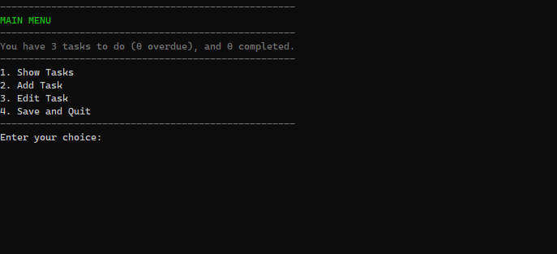
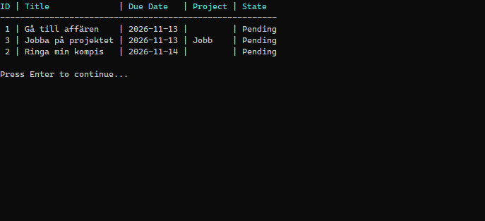

# Lexicon.TODO

A text-based to-do list that lets users manage a set of tasks in a user-friendly but simple interface, and save them to a file in JSON format.

## Features

- Add a task with a title, a due date and an optional project
- Show tasks, sorted by due date or by project
- Edit a task: update the title, due date or project, mark it as completed, or delete it (with confirmation)
- The main menu shows the number of pending, overdue and completed tasks
- Tasks are saved to a JSON file and loaded again at startup
- Unit tests for the task logic (`Lexicon.TODO.Tests`)

## Screenshots





## Technologies

- C# and .NET 10
- `System.Text.Json` for saving and loading
- xUnit for unit tests
- ReSharper for code analysis and refactoring
- Claude Code for code review and learning
- Git and GitHub

## How to run

Requires the [.NET 10 SDK](https://dotnet.microsoft.com/download).

```
git clone https://github.com/Nacorpio/Lexicon.TODO.git
cd Lexicon.TODO
dotnet run --project Lexicon.TODO
```

To run the unit tests:

```
dotnet test
```

## How data is saved and loaded

Tasks are stored in `Data/tasks.json` next to the executable. When you start the app with `dotnet run`, that is `Lexicon.TODO/bin/Debug/net10.0/Data/tasks.json`. The file is an indented JSON array with one object per task, and the task state is stored as text:

```json
[
  {
    "Id": 1,
    "Title": "Gå till affären",
    "DueDate": "2026-11-13T00:00:00",
    "State": "Pending",
    "Project": null
  },
  {
    "Id": 2,
    "Title": "Ringa min kompis",
    "DueDate": "2026-11-14T00:00:00",
    "State": "Pending",
    "Project": null
  },
  {
    "Id": 3,
    "Title": "Jobba på projektet",
    "DueDate": "2026-11-13T00:00:00",
    "State": "Pending",
    "Project": "Jobb"
  }
]
```

- **Loading:** the file is read once at startup.
- **Saving:** tasks are saved only when you choose **Save and Quit**. If you close the window without it, the changes are lost.
- **Missing file:** the app starts with an empty list, and the file is created on the first save.
- **Corrupt or unreadable file:** the app shows a message and starts empty. It does not save during that session, so the bad file is never overwritten.

## Design

The code is split by responsibility. The `TaskManager` holds the task list and the rules for changing it, and it never writes to the console. `TaskStorage` only reads and writes the JSON file. The console handling (input, menus and tables) is in separate helper classes, and `Program.cs` only runs the menu loop.

`TaskItem` is an immutable record. Updating a task creates a modified copy with a `with` expression. Menus are built from enums, so the number shown to the user is the enum value, and the labels are kept separate from the enum names.

### Project structure

```
Lexicon.TODO/
  Lexicon.TODO/
    Program.cs            menu loop
    MenuHandlers.cs       one handler per menu choice
    Models/               TaskItem, TaskState, menu enums
    Services/             TaskManager, TaskStorage
    Helpers/              InputHelper, ConsoleHelper, MenuHelper, MenuLabels
  Lexicon.TODO.Tests/     xUnit tests
```

## Known limitations

- Tasks are saved only when you choose **Save and Quit**.
- The next Id is the highest existing Id plus 1, so the highest Id can be reused after that task is deleted.
- A project cannot be cleared once it is set. Updating a task keeps the old value when no new one is given.
- Due dates in the past are allowed.
- There is no search or filtering.
